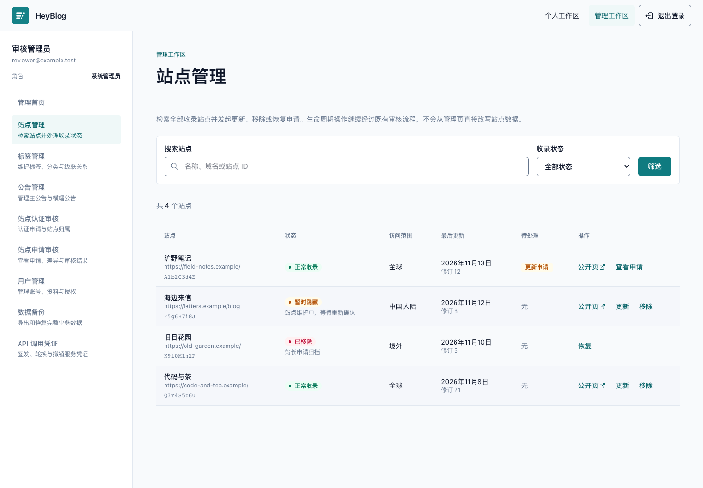

# 站点管理

站点管理为管理员提供全部站点的只读目录，并把更新、移除和恢复操作接入既有申请审核流程。它不提供绕过审核的数据库写入入口，也不会物理删除站点。



## 权限与边界

- `SYS_ADMIN` 可直接访问；`ADMIN` 需要 `site.manage` 权限。
- 列表接口和页面都会检查权限，前端导航检查不能替代 API 授权。
- `site.manage` 只允许读取管理目录和发起既有申请。查看或处理待审核申请仍需要 `site_audit.review`。
- 页面、SSR 请求和 API 响应均使用 `private, no-store`，不缓存管理员数据。
- Web 只通过带 Web token 和访问会话的私有 API 读取数据，不连接数据库。

## 页面行为

`/management/sites` 支持：

- 按名称、域名、9 位短 ID 或自定义 ID 搜索；
- 按 `VISIBLE`、`HIDDEN`、`REMOVED` 状态筛选；
- 每页 20 条的服务端分页；
- 展示访问范围、当前修订、可见性原因和待处理申请；
- 跳转公开页，或发起更新、移除、恢复申请；
- 对有审核权限的管理员提供待处理申请入口。

管理首页的“站点管理”分组包含站点目录、站点认证审核和站点申请审核。窄屏下表格保持关键列宽并允许横向滚动。

## 生命周期语义

| 页面动作 | 申请动作 | 审核通过后的结果 |
| --- | --- | --- |
| 更新 | `UPDATE` | 更新规范化站点快照并增加修订号 |
| 移除 | `DELETE` | 将可见性设为 `REMOVED` 并保留原因和历史记录 |
| 恢复 | `RESTORE` | 将可见性恢复为 `VISIBLE` |

“移除”是可恢复的归档语义，不是硬删除。申请处于 `PENDING` 时，站点当前状态不变，列表显示待处理动作并阻止重复发起另一个生命周期申请。`HIDDEN` 是已有目录状态，本页面首版只提供筛选和说明，不新增直接切换状态的写接口。

## API 契约

`GET /api/web/management/sites` 接受以下查询参数：

| 参数 | 约束 | 默认值 |
| --- | --- | --- |
| `q` | 去除首尾空格，最多 160 个字符 | 空 |
| `visibility` | 空、`VISIBLE`、`HIDDEN` 或 `REMOVED` | 空 |
| `page` | 1 到 1,000,000 | 1 |
| `page_size` | 1 到 50 | 20 |

成功响应为：

```json
{
  "items": [
    {
      "short_id": "A1b2C3d4E",
      "custom_id": "example-blog",
      "name": "Example Blog",
      "url": "https://example.com/",
      "access_scope": "ALL",
      "visibility": "VISIBLE",
      "revision": 3,
      "joined_at": "2026-01-02T03:04:05Z",
      "updated_at": "2026-02-03T04:05:06Z",
      "pending_audit": {
        "id": "019abcde-0000-7000-8000-000000000000",
        "action": "UPDATE"
      }
    }
  ],
  "page": 1,
  "page_size": 20,
  "total_items": 1,
  "total_pages": 1
}
```

`custom_id`、`visibility_reason` 和 `pending_audit` 没有值时省略。URL 由服务端规范化地址字段构造，Web 会在运行时校验完整响应后再渲染。

## 本地部署前测试

先按[贡献指南](../CONTRIBUTING.md#本地开发)启动 PostgreSQL/AGE、Redis、Mailpit、API 和 Web，并使用仅包含测试数据的开发数据库。登录一个本地 `SYS_ADMIN`，或由现有系统管理员给本地 `ADMIN` 授予 `site.manage`；不要在生产数据库中做以下验证。

1. 打开 `/management`，确认“站点管理”卡片和侧边导航可见。
2. 打开 `/management/sites`，分别用名称、域名、短 ID、自定义 ID 和状态筛选，确认 URL 保留筛选与页码。
3. 用浏览器窄屏模式确认表格可横向滚动，操作链接保持至少 44px 触控高度；同时检查浅色、深色和键盘焦点状态。
4. 对一个测试站点发起“移除”，返回列表确认出现“移除申请”，且站点仍保持原可见性。
5. 使用带 `site_audit.review` 权限的另一个本地管理员批准申请，确认列表状态变为“已移除”，公开站点详情不再可用。
6. 发起并批准“恢复”，确认站点重新为“正常收录”，公开详情恢复。
7. 如需数据库只读核对，在开发容器中查询站点与审核记录；不要直接修改生命周期字段：

   ```bash
   docker compose -f infra/docker/docker-compose.env.yaml exec postgres \
     psql --username postgres --dbname heyblog \
     --command "SELECT short_id, visibility, visibility_reason, revision FROM directory.sites ORDER BY updated_at DESC LIMIT 10;"

   docker compose -f infra/docker/docker-compose.env.yaml exec postgres \
     psql --username postgres --dbname heyblog \
     --command "SELECT action, status, site_id, created_at FROM directory.site_audits ORDER BY created_at DESC LIMIT 10;"
   ```

## 自动验证

API PR 应至少运行：

```bash
mise run //apps/api:verify
mise run //apps/api:test:integration
```

Web PR 应至少运行：

```bash
mise run //apps/web:verify
```

跨模块合并前运行：

```bash
mise run verify
```

API 集成测试覆盖名称、域名、短 ID、自定义 ID、状态筛选、分页边界、规范化 URL、可见性原因和待审核动作。Web 测试覆盖不可信响应解析、查询规范化、权限导航、SSR 转发、错误状态与匿名重定向；页面截图用于人工检查真实 SSR 输出和主要视觉状态。
